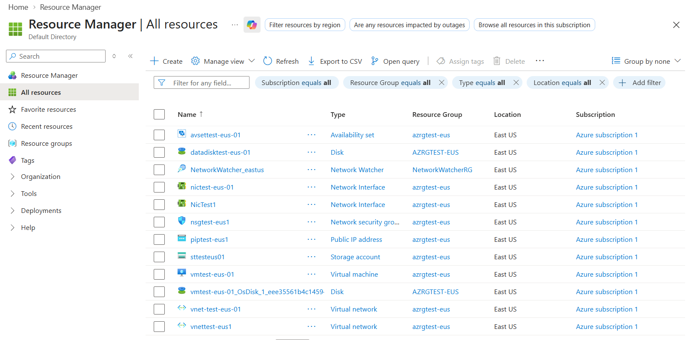
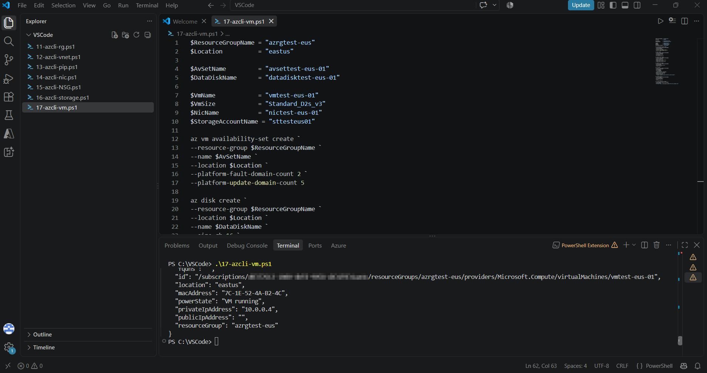

# PowerShell & Azure Automation Scripts


A collection of scripts I've written for infrastructure and systems administration work: Active Directory management, Azure provisioning, Microsoft 365 administration, and software deployment.

Some come from a personal Azure lab environment I use to build and practice hands-on skills. Others are sanitized versions of scripts I've written and used in production at previous roles. All domains, server names, and credentials have been replaced with placeholders such as `contoso.com`.

---

## Contents

| Folder | What's inside |
| --- | --- |
| [`azure-powershell/`](azure-powershell) | Step-by-step lab that builds an Azure environment with the **Az PowerShell** module: resource group, VNet/subnets, Windows Server VM, NSG, data disk, storage account, and teardown. |
| [`azure-cli/`](azure-cli) | The same kind of environment built with the **Azure CLI** (`az`): VNet, public IP, NIC, NSG, storage, and an Ubuntu VM in an availability set with boot diagnostics. |
| [`m365/`](m365) | Runbook snippets for **Exchange Online** (mailboxes, permissions, distribution groups) and **Microsoft Entra ID** via Microsoft Graph. |
| [`automation/`](automation) | Production-style scripts: an **inactive AD account report** and an unattended **Office 2019 deployment**. |

## Highlights

### [`Get-InactiveADUsers.ps1`](automation/Get-InactiveADUsers.ps1)
Finds stale Active Directory accounts as the first step of an AD cleanup. It skips service-account OUs and privileged group members, treats never-logged-on accounts correctly, and exports a sorted CSV report. The script is read-only and changes nothing in AD.

### [`Install-Office2019.ps1`](automation/Install-Office2019.ps1)
A self-contained Office Deployment Tool wrapper. It generates its own XML configs, removes existing Click-to-Run Office, installs Office 2019 silently from a network share, verifies the result in the registry, logs every step, and returns a meaningful exit code for RMM/SCCM tooling.

### Azure lab: PowerShell vs. CLI
Two versions of the same infrastructure, one built with Az PowerShell and one with the Azure CLI. They show the same networking, compute, and storage concepts in both tools.



<details>
<summary>Running the CLI VM deployment from VS Code</summary>



</details>

## Skills demonstrated

- **Azure IaaS:** resource groups, VNets and subnetting, NSGs, public IPs, NICs, VMs (Windows and Linux), availability sets, managed disks, storage accounts, boot diagnostics
- **Infrastructure as code:** repeatable, parameterized deployments with Az PowerShell and the Azure CLI
- **Identity:** Active Directory reporting and hygiene, Entra ID user/group management with Microsoft Graph
- **Messaging:** Exchange Online mailbox, permission, and distribution group administration
- **Endpoint/software deployment:** silent Office installs with the Office Deployment Tool, logging, and exit codes
- **Security basics:** restricting management ports to trusted IPs, excluding privileged accounts from automated actions, keeping secrets out of source

## Getting started

```powershell
# Azure PowerShell
Install-Module Az -Scope CurrentUser
Connect-AzAccount

# Azure CLI  (https://learn.microsoft.com/cli/azure/install-azure-cli)
az login

# Microsoft 365
Install-Module ExchangeOnlineManagement, Microsoft.Graph -Scope CurrentUser
```

Every script starts with comment-based help, so you can see what it does before running it:

```powershell
Get-Help .\automation\Get-InactiveADUsers.ps1 -Full
```

The lab scripts are numbered and meant to run in order. Each script lists its prerequisites under `Depends on` in its header.

> **Cost warning:** The Azure lab scripts create billable resources. Run `azure-powershell/99-Remove-Lab.ps1` (or `az group delete --name azrgtest-eus`) when you're done.

## Disclaimer

These scripts are provided as examples. Review them and test in a non-production environment before using them against real infrastructure.
